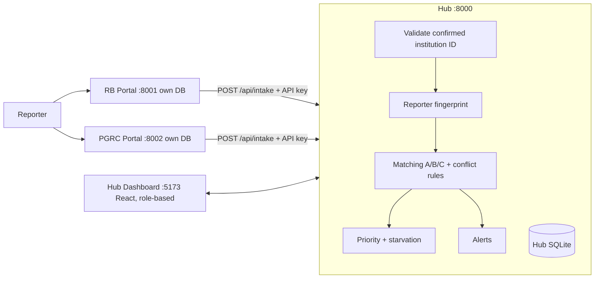

# CLAUDE.md — SIH 2026 · PS 26264 · Integrated Complaint Monitoring Hub

> Put this file at the ROOT of the project repo. Claude Code loads CLAUDE.md automatically.
> It is the full project memory. Planning gates 1-3 were approved in a previous chat; gates 4-5 are condensed in sections 15-17.
> **Do NOT write code until the user says "START BUILD".**

## 1. Project, person, deadline
- Smart India Hackathon 2026, Problem Statement 26264: *Integrated Dashboard for Monitoring and Tracking Institution-Related Complaint Cases Across AICTE Bureaus/Cells* (RB = Regulation Bureau, PGRC = Public Grievance Redressal Cell, plus other bureaus/regional offices). The full PS text is in `sih_ps_2026.txt` (source of truth: every stated requirement, deliverable and expected outcome must be covered).
- The user is a CSE student: strong at research and ideas, weak at coding, intermediate DSA, Python user. **Claude writes all code. The user runs it and must be able to explain it to judges.**
- Laptop: Lenovo Yoga Slim 7i, 16 GB RAM, no dedicated GPU, assume Windows. Free tools only.
- Team of 6: the user builds alone; others do PPT, synthetic dataset, testing, n8n workflow.
- Key dates: **25 Oct college review** (PPT done + demo-ready core), **26 Oct** remaining features + fixes, feature freeze evening, **27 Oct submission-ready** (video, PPT), 28 Oct official deadline (buffer only).

## 2. Non-negotiables
1. Synthetic data only. No real complaints, people, colleges, phone numbers or emails.
2. **Humans make final decisions.** The system suggests and highlights; officers confirm/reject.
3. Simple rules over AI wherever rules are enough. AI only for complaint-text semantic similarity (embeddings), with a TF-IDF fallback. Not RAG, no chatbot, no external paid LLM APIs.
4. **Reliability over cleverness.** A smaller feature set that never crashes beats a larger one that does.

## 3. Working rules for Claude
- One module per task. Deliver complete working files (not snippets), exact run commands, and a quick test the user can run.
- Few dependencies, **pinned versions**. Short comments so the user can explain the code.
- After each module give a 3-line "how it works" the user can say out loud.
- When the user pastes an error: fix the root cause and give the full corrected file.
- No features outside the agreed MVP unless asked. Never claim something works unless reasoned through or tested; say what the user must test.
- Warn early if something will not fit the time and propose a cut.
- `git init` on day 1; commit after every working module so the user can roll back.
- After each module update `FEATURES.md` (status per feature) and `PROGRESS.md` (what is done, what is next).
- Be concise. Lead with the answer.

## 4. PS requirements checklist (all must be covered)
MUST (by 25 Oct review): institution profile with ID/name/address/region and complaint history; case tracking (case ID, receipt date, category, status, bureau, officer, last action, date of last action); complaint entry; **overlap detection across bureaus + alert "Potential Overlapping Cases – Coordination Required"; officer confirm/reject; linking related cases**; dashboard KPIs (total, pending, under process, disposed, transferred, escalated, pending beyond timeline, institution-wise status, bureau-wise workload); chronological action history with officer/bureau/timestamp/remarks; search by institution name, AICTE ID, case ID; filters by bureau, region, category, status, date range; in-app duplicate/overlap alerts; basic bureau/region/status reports and institution-wise history; role views for all target users; audit trail; synthetic dataset; real-time recompute.
SHOULD (by 27 Oct): next action + expected disposal date; supporting-document reference; transfer/escalation action and history; SLA/timeline alerts, pending reminders, escalation alerts; ageing analysis, disposal rate, monthly/quarterly reports; overlap report; data-driven Insights panel; map on confirm card; n8n demo workflow.
LATER (future scope, stub files only): email/SMS delivery, real Aadhaar/DigiLocker/OTP verification, real SSO, PostgreSQL migration, integration with real AICTE portal, multilingual matching, case graph view (N4), Attention Index (N5), local-LLM summaries, "colleges near me" and pin drop.
Target users to cover: RB, PGRC, other bureaus/cells, regional offices, senior management, competent authority. "Data-driven decision-making" is covered by the Insights panel + reports.

## 5. Architecture (hub-and-spoke)
Two existing government portals are NOT modified. A separate **hub** ("brain") receives every complaint, handles each college separately, and does all analysis. Portals here are mocks.

Stack: Python 3.11, FastAPI, SQLAlchemy 2, SQLite; React + Vite + Tailwind + Recharts; `rapidfuzz`; `fastembed` (ONNX, no torch) with TF-IDF fallback; PyJWT + hashlib PBKDF2 for auth (avoid bcrypt on Windows); Leaflet + OpenStreetMap for maps (no Google Maps: needs billing). Portals: two tiny FastAPI apps, own SQLite, one HTML page each, shared JS widget. `run_all.py` starts everything. If portals cannot be built in time, fallback = portals as routes inside the hub app.
Portals keep a case with `sync_status=pending` and retry if the hub is down (outbox).
Officers log actions in the **hub UI** for the prototype (production: bureau systems call `POST /api/actions`, stub it).

## 6. Reporter journey and institution resolution (decided)
**Every reporter, on both portals, goes through the Institution Finder first.**
1. **Institution Finder (shared JS widget):** type a name → live suggestions from the hub registry → **confirm card** (official name, AICTE ID, address, map pin from dataset lat/lng) → reporter clicks Yes → ID locks. If unsure: guided questions (state → district → type → area → programs) narrow candidates (plain filtering). If still not found: "My institution isn't listed" → free-text details → case becomes `unverified_institution` and the receipt says "pending verification".
2. **Reporter verification:** mock OTP (demo mode returns the code) → hashed fingerprint of phone/email (no raw personal data stored in hub).
3. **Complaint form:** institution shown as read-only banner with a "Change" link back to step 1. One institution per complaint.
4. **Receipt** with case number, institution name and ID.
- On confirmation the portal issues a **signed short-lived token (HMAC, ~30 min)** containing the institution ID; the form cannot be submitted without it. (First thing to drop if behind: keep the UI gate and the hub's ID check.)
- **The hub NEVER guesses an institution.** It only validates that the confirmed ID exists in the registry; unverified cases go to a Needs Review queue where an officer picks the ID, and the typed name is saved as a learned alias.
- A reporter-confirmed college is not guaranteed true; officers see `resolution_method`.

**Resolver used by the search endpoint (rules, no AI):** ID check → normalize (lowercase, strip punctuation, expand engg→engineering, clg→college, univ→university, drop filler words) → exact alias lookup (curated aliases + auto-generated acronyms) → `rapidfuzz` score against names and aliases + bonus for matching location words → decide: clear winner = single suggestion; several close candidates or a parent institution with many children = show top 3, never auto-pick; low score = nothing. Example: "CEG", "CEG Guindy" → one college; "Anna University Chennai" → candidates, no guess (parent_id grouping). (Demo data uses fictional institutions only.)

## 7. Detection logic (the novelty: N1 + N2 + N3)
All comparisons are **within the same institution only** (small, fast, fewer false matches). Every suggestion stores **reasons** (JSON) and waits for an officer to confirm/reject. Rejected pairs are never re-suggested.
- **A. Same-reporter duplicate:** same reporter fingerprint, different portal, text similarity ≥ T_A → "duplicate" suggestion.
- **B. Corroboration:** different reporters, same category, similarity ≥ T_B → cluster suggestion; "corroborated by N independent reporters". Only distinct validated reporters count; boost is capped.
- **C. Cross-bureau overlap:** open cases at the same institution in two or more different bureaus → "Potential Overlapping Cases – Coordination Required". Needs no text similarity.
- **Conflict (stance rules):** every action type has a stance (below). CONFLICT = ENFORCING in one bureau vs CLOSING in another on the same institution/related category within N days. DUPLICATE ACTION = both bureaus took an ENFORCING or REQUESTING action of the same kind within N days.
  - ENFORCING: Show-Cause Notice Issued, Inspection Ordered, Penalty Proposed. REQUESTING: Documents Sought, Reply Sought from Institution. CLOSING: Closed - No Action, Disposed - Unsubstantiated, Disposed - Action Taken. NEUTRAL: Acknowledged, Under Review, Transferred, Escalated to Competent Authority.
- **Lead-bureau suggestion (ordered rules, shows the rule that fired):** 1) category ownership table (regulatory/approval → RB; student/individual grievances like fee refund, harassment → PGRC); 2) a bureau that already issued an ENFORCING action leads; 3) tie-break: older open case leads; 4) otherwise "no lead suggested; refer to competent authority". If bureaus disagree the competent authority decides.
- Initial thresholds (placeholders to tune on synthetic data): T_A ≈ 0.75, T_B ≈ 0.65, stored in a config table. Similarity = blend of embedding cosine and keyword overlap; TF-IDF only if embeddings fail to load.
- The category-ownership, stance, SLA and threshold tables are **assumptions about AICTE mandates**, configurable and labelled as such in the PPT.

## 8. Priority and starvation (N3)
`priority = severity×10 + min(distinct corroborators,4)×5 + min(age_days,60)×0.3`. A corroboration boost is shown as "potential +X" and **applied only after an officer confirms the link**. Starvation alert: no action for N days. SLA: configurable per bureau/category (assumed e.g. PGRC 30 days, RB 45 days). Ageing buckets 0-7, 8-15, 16-30, 30+ days.

## 9. Data model (hub DB)
- institution(aicte_id PK, official_name, name_normalized, parent_id, address_line, area, district, state, pincode, region, type, lat, lng, programs, established_year)
- institution_alias(alias_normalized, institution_id, alias_type, source: curated/auto/learned)
- reporter(id, fingerprint_hash UNIQUE, reporter_type, validation_method, validated_at)
- case(hub_case_id, source_system, source_case_no, institution_id NULL if unverified, resolution_method REPORTER_CONFIRMED/GUIDED/UNLISTED, finder_answers JSON, reporter_id, category, title, description, received_at, status, assigned_bureau, assigned_officer, severity, priority_score, expected_disposal_date, last_action_at, cluster_id)
- case_action(case_id, seq, action_type, stance, actor, bureau, remarks, doc_ref, at, from_bureau, to_bureau)
- link_suggestion(case_a, case_b, link_type SAME_REPORTER/CORROBORATION/CROSS_BUREAU/CONFLICT, score, reasons JSON, status SUGGESTED/CONFIRMED/REJECTED, decided_by, decided_at, note)
- cluster, alert(type, severity, case/institution ref, message, created_at, acknowledged_by), user(username, password_hash, role, bureau, region), audit_log, config tables: sla_policy, category_ownership, action_type_stance, thresholds.
Statuses: Pending, Under Process, Disposed, Transferred, Escalated, plus `unverified_institution` (needs review).

## 10. Folder structure (one file per feature; stubs must not crash)
```
sih-hub/
  CLAUDE.md  FEATURES.md  PROGRESS.md  run_all.py  reset_demo.py
  hub/backend/app/ main.py db.py models.py config.py seed.py
    routers/  institutions intake reporters cases matching conflicts corroboration starvation alerts dashboard reports search auth audit
              graph(STUB) attention_index(STUB) notifications(STUB) documents(STUB) llm_summary(STUB)
    services/ (same names; logic here)   tests/
  hub/frontend/src/ pages/ Login Dashboard Cases CaseDetail InstitutionProfile Overlaps Alerts Reports Insights NeedsReview GraphView(STUB) AttentionIndex(STUB)
  portal_rb/ app.py static/index.html rb.db        portal_pgrc/ app.py static/index.html pgrc.db
  shared/ institution-finder.js institution-finder.css
  data/ institutions.csv institution_aliases.csv institution_name_tests.csv reporters.csv cases.csv actions.csv scenarios.md
```
**Stub rule:** every feature gets a file even if not implemented. Backend stub returns HTTP 501 "planned"; frontend stub shows a "Coming soon" card; `FEATURES.md` maps feature → file → status (DONE / STUB) so unfinished modules can be completed after 25 Oct. Stubs do not count toward progress.

## 11. API (draft; keep stable once built)
Hub: `GET /api/institutions/search?q=`, `GET /api/institutions/filters`, `GET /api/institutions/{id}`, `POST /api/intake` (API key per portal; carries verified_institution_id, resolution_method, finder_answers, reporter fingerprint, case fields), `POST /api/actions` (stub for bureau sync), cases list/detail/search/filters, link decisions (confirm/reject), alerts, dashboard KPIs, reports (+CSV), auth login.
Portals: `POST /institution/confirm` → institution_token; `POST /otp/request` → demo_otp; `POST /otp/verify` → verification_token; `POST /submit` → {portal_case_no, hub_case_id, alerts_created:[{alert_type, severity, message, institution, cases, reasons, suggested_lead, dashboard_link}]}.

## 12. Role-based views (hub dashboard only; seeded JWT accounts, one per role; fallback = role dropdown)
RB officer: RB cases, overlaps/conflicts involving RB; log actions, confirm/reject, transfer. PGRC officer: same for PGRC. Other bureau: cases assigned to them + institution overlap panel. Regional office: own region only; view, remarks, escalate. Senior management: everything read-only, KPIs, ageing, Insights, reports/export. Competent authority: everything + escalations + open conflicts; final decision on lead bureau.

## 13. Synthetic data (a teammate is preparing the CSVs; spec below)
- institutions.csv: 40 fictional institutions, IDs `SYN-0001..0040`, 4 parent groups, 2 pairs of similar names, lat/lng inside stated district. **SYN-0040 = clean demo college with zero cases** (used by n8n replay).
- institution_aliases.csv ~160 (acronym, short name, old name, location-based, abbreviation variant, typo); ambiguous aliases for parent groups.
- institution_name_tests.csv 45+ rows: RESOLVED / AMBIGUOUS / NOT_LISTED.
- reporters.csv 80 (emails @example.com, phones 0000000001...). cases.csv 150 (~45 planted + filler, Apr–Oct 2026, ~30% disposed, one repeat-complaint college with 8+ cases). actions.csv ~300 using only the controlled action types in section 7.
- Categories: Fee/Refund; Faculty Shortage/Qualification; Infrastructure/Lab; Admission Irregularity; Approval/Affiliation; Ragging/Harassment; Placement Misrepresentation; Exam/Result; Hostel/Mess; Scholarship; Misleading Advertisement/Accreditation Claim.
- Planted scenarios: S1 cross-bureau overlap; S2 same reporter both portals; S3 corroboration (3 reporters); S4 conflict (show-cause vs closed); S5 duplicate action; S6-S8 hard negatives (same college unrelated issues; same reporter two colleges; identical wording two colleges); S9 stalled 45+ days; S10 SLA due in 3 days/overdue; S11 transferred; S12 escalated; S13 unlisted institution; S14 informal wording; S15 heavy repeat college; S16 ambiguous parent.
- **If the dataset is late:** write a small seed script (10 institutions, ~30 cases covering S1-S4, S9) so building is never blocked; swap in the real CSVs when they arrive.

## 14. n8n (ONE workflow, demo video only, optional, off the critical path)
"Complaint Journey Replay" built by a teammate: replays 2 reporters (RB then PGRC, same demo college SYN-0040) through finder search → institution details + OSM map link → confirm → mock OTP → submit → IF `alerts_created` → Telegram notification ("suggested lead bureau (suggestion only)"). Labelled "demo replay; production portals call the hub directly". Hub needs: portal confirm/OTP/submit endpoints, `alerts_created` in the submit response, `reset_demo.py`. No hub webhook, no digest. Fallback: teammate records a pinned-data version labelled "illustrative replay".

## 15. Proposed build order (modules, each with an acceptance test)
M0 scaffold + git + run_all + FEATURES.md stubs (all stubs load). M1 models + seed loader for CSVs. M2 registry API + resolver, tested against institution_name_tests.csv. M3 auth/roles (cut to dropdown if behind). M4 intake API + reporter fingerprint + case + case_action. M5 portals + Institution Finder widget + mock OTP + token + outbox. M6 matching A/B/C (TF-IDF baseline) + link_suggestion + alerts. M7 officer confirm/reject + audit + priority update. M8 dashboard: KPIs, cases list with search/filters, case detail with history, institution profile, overlaps and alerts pages, Needs Review. M9 conflict rules + lead-bureau suggestion. M10 starvation/SLA alerts. M11 reports + CSV export + role view polish + Insights. M12 embeddings upgrade (fastembed) with TF-IDF fallback. M13 n8n endpoints + reset_demo.py.

## 16. Timeline, cut list, fallback (written 24 Oct afternoon: about a day was spent planning)
- **Be honest:** "80% by 25 Oct" is aggressive. Define the 25 Oct review scope as the **core flow**: finder → portal submit → hub intake → overlap alert → officer confirm/reject → dashboard + case history + search/filters. PPT done by teammates.
- 24 Oct: M0-M5 (as far as possible; at minimum M0-M4 and one portal). 25 Oct morning: M6-M7, then M8 minimal. 26 Oct: rest of M8, M9-M11, fixes from review feedback; feature freeze evening. 27 Oct: M12/M13 only if stable, video, PPT final, full test run. 28 Oct: buffer only.
- **Cut order (first to drop):** n8n → map → embeddings upgrade (keep TF-IDF) → guided-filter questions → monthly/quarterly report → login (use role dropdown) → lead-bureau suggestion polish → conflict detection → starvation polish. **Never cut:** finder confirm, intake, overlap C, alert, officer confirm/reject, case history, dashboard KPIs, search.
- **25 Oct review fallback:** record a screen video of the working flow beforehand and keep a seeded DB snapshot so the live demo can be restored in one command.

## 17. Demo story and judge questions
**Wow moment (3-minute demo):** a reporter files on the RB portal (finder confirms the college with a map pin); a second reporter files on the PGRC portal about the same college; the hub dashboard instantly shows **"Potential Overlapping Cases – Coordination Required"** with reasons and a suggested lead bureau; the officer confirms the link, both cases show linked history, priority updates. Then: corroboration cluster ("3 independent reporters"), conflict alert (show-cause vs closed), stalled-case panel, reports. Close with scalability and "humans decide".
Prepare answers for: Why a hub instead of changing the portals? How do you avoid false links? What if reporters give wrong college names? Is the data private/secure? How does it scale (PostgreSQL, indexing by institution, queue)? Why local embeddings and not an LLM? Could coordinated fake complaints game the priority? (capped, distinct validated reporters, officer confirms.) What are your assumptions about bureau rules? (configurable tables.) What is future scope?

## 18. Status at handoff (24 Oct)
Gates 1-3 approved in substance; defaults accepted: Windows, boost only after officer confirmation, map = SHOULD, n8n = SHOULD. No code written. Dataset teammate due 24 Oct 10:00 (files 1-3) and 18:00 (files 4-6); n8n teammate due 25 Oct (pinned) and 26 Oct 12:00 (wired).
